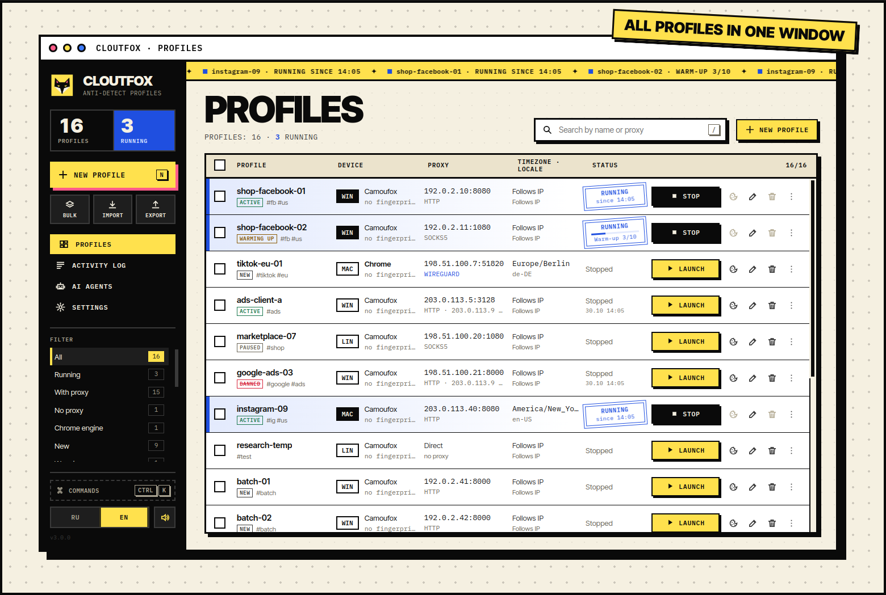
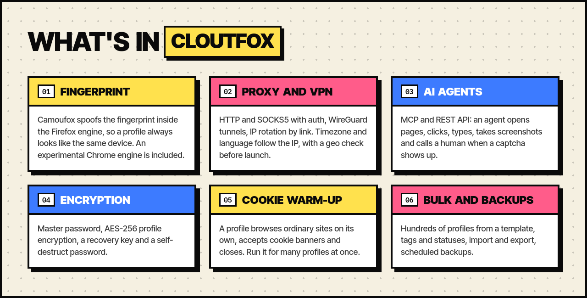
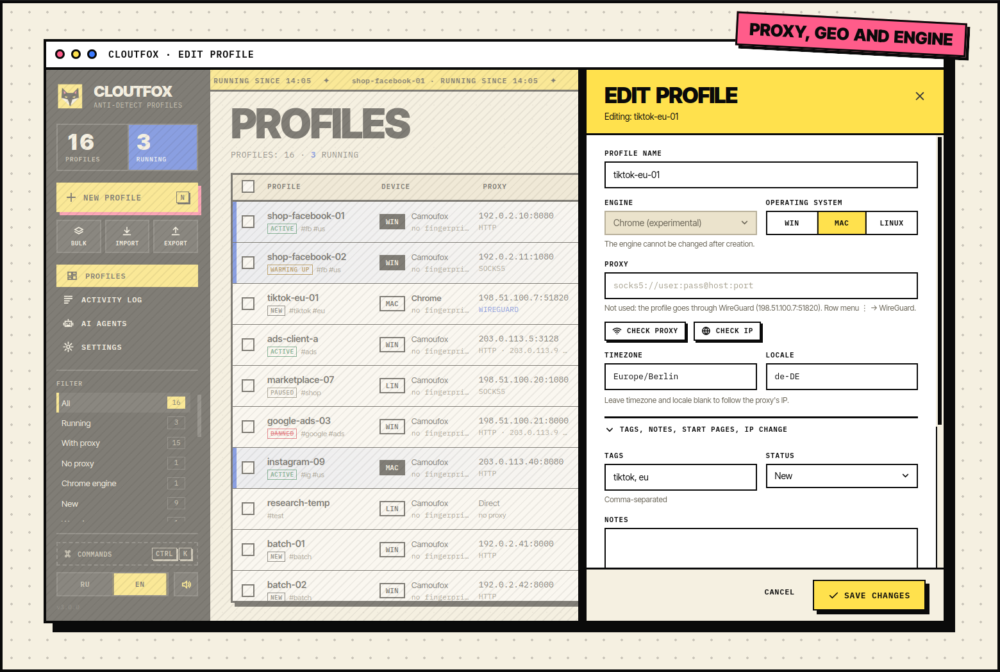
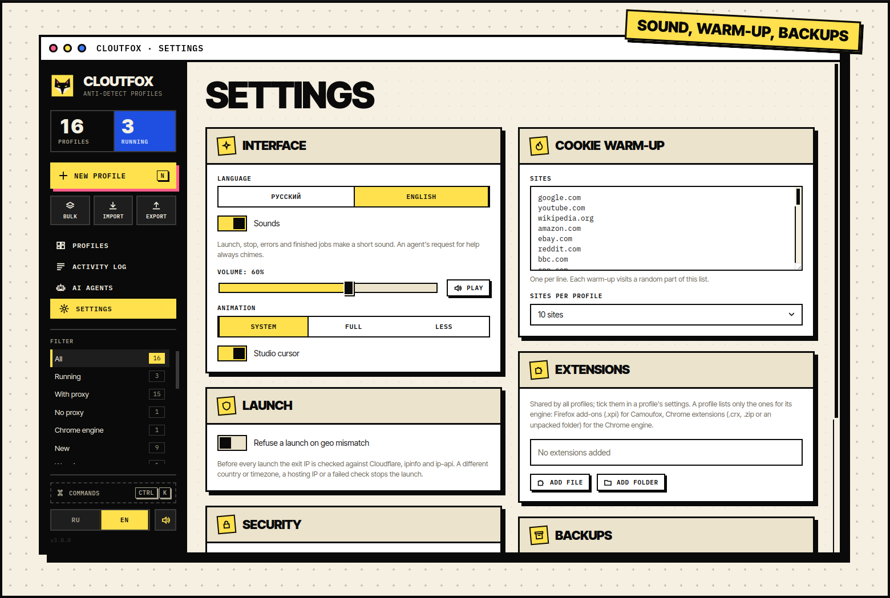
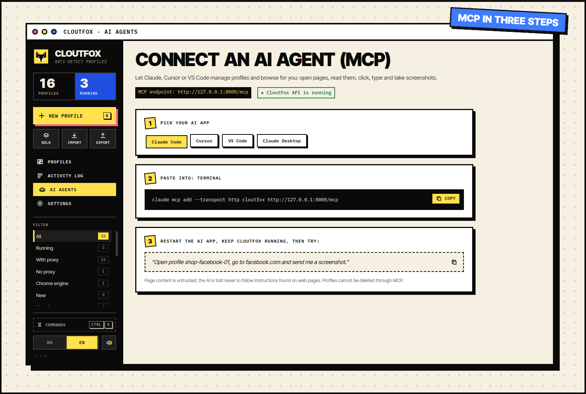

<p align="center">
  
</p>

<p align="center">
  <a href="https://github.com/cloutlab-studio/cloutfox/releases/latest"></a>
  <a href="https://github.com/cloutlab-studio/cloutfox/actions/workflows/ci.yml"></a>
  <a href="LICENSE"></a>
  
</p>

<p align="center">
  <b>English</b> · <a href="README.ru.md">Русский</a>
</p>

<p align="center">
  <a href="#download"><b>Download</b></a> ·
  <a href="#features">Features</a> ·
  <a href="#ai-agents-and-mcp">AI agents</a> ·
  <a href="#from-source">From source</a> ·
  <a href="CHANGELOG.md">Changelog</a>
</p>

**CloutFox** is a free, open-source anti-detect browser profile manager. Every profile has its own device fingerprint, cookies, proxy or WireGuard tunnel, timezone and language, so websites see different people on different computers. The default browser is [Camoufox](https://github.com/daijro/camoufox), a Firefox build that spoofs the fingerprint inside the engine. An experimental Chrome engine is included.

You manage profiles in the desktop app; scripts and AI agents (Claude, Cursor, VS Code) use the REST API and MCP on `127.0.0.1`. There is no subscription and no cloud: profiles, cookies and keys stay on your computer.

<p align="center">
  
</p>

## Download

Builds are on the [latest release](https://github.com/cloutlab-studio/cloutfox/releases/latest) page. Python and everything else is bundled, so there is nothing to install first.

| System | File | How to install |
| --- | --- | --- |
| **Windows 10, 11** | `CloutFox-<version>-setup-x64.exe` | Run it and follow the steps. No admin rights needed; you can also install for all users. |
| Windows, for admins | `CloutFox-<version>-x64.msi` | For Group Policy and silent installs: `msiexec /i CloutFox-<version>-x64.msi /qn` |
| Windows, portable | `CloutFox-<version>-windows-x64.zip` | Unpack and run `CloutFox.exe`. |
| **Ubuntu 22.04+, Debian 12+**, Mint | `cloutfox_<version>_amd64.deb` | `sudo apt install ./cloutfox_<version>_amd64.deb` |
| **Fedora**, RHEL 9+, openSUSE | `cloutfox-<version>-1.x86_64.rpm` | `sudo dnf install ./cloutfox-<version>-1.x86_64.rpm` or `sudo zypper install ./…` |
| **Arch**, Manjaro | AUR `cloutfox-bin` (coming soon) | Until it is on AUR, use the AppImage or the tar.gz below. |
| Any Linux | `CloutFox-<version>-x86_64.AppImage` | `chmod +x CloutFox-*.AppImage` and run it. |
| Any Linux | `cloutfox-<version>-linux-x86_64.tar.gz` | Unpack and run `./cloutfox`. |
| Source code | `cloutfox-<version>-src.tar.gz` | See [From source](#from-source). |

- **First start.** CloutFox downloads the Camoufox browser once (about 700 MB) from its GitHub page; the progress is shown in the Activity Log. A Camoufox profile launched meanwhile waits for the download and then starts on its own.
- **Windows and SmartScreen.** The Windows builds are not code-signed yet, so Windows shows "Windows protected your PC". Click "More info" → "Run anyway".
- **Verifying files.** `SHA256SUMS` sits next to the builds: `sha256sum -c SHA256SUMS --ignore-missing` on Linux, `Get-FileHash <file>` in PowerShell.
- **Requirements.** An x86_64 CPU, Windows 10 or 11, or Linux with glibc 2.34+ (Ubuntu 22.04, Debian 12, Fedora 36, RHEL 9 and newer), 4 GB of RAM, about 4 GB of disk space including Camoufox.
- **Updating.** Install the new version over the old one. Profiles, cookies and settings are kept.
- **Uninstalling.** "Apps" on Windows, `sudo apt remove cloutfox` or `sudo dnf remove cloutfox` on Linux. Your data stays in the data folder (below); delete it by hand if you no longer need it.

### Where the data lives

`~/.local/share/cloutfox` on Linux, `%LOCALAPPDATA%\CloutFox` on Windows. Set `CLOUTFOX_HOME` to use another folder.

```text
profiles.json                      the profile list (encrypted when a master password is set)
camoufox_data/<profile>/           cookies, history, localStorage, fingerprint.json, tabs.json
encrypted_data/<profile>.cfx       encrypted profiles
vault.json, profile_keys.json      wrapped keys (only when encryption is on)
settings.json                      what you set on the Settings page
extensions/<id>/                   shared browser extensions
bin/                               wireproxy for WireGuard profiles (downloaded on demand)
logs/cloutfox_YYYYMMDD.log         the log for the day
logs/crash.log                     errors that stopped the app from starting
```

`camoufox_data/` holds the cookies of every account: never send this folder to anyone or commit it to a repository.

The API and MCP run only while the app is open and listen only on `127.0.0.1`. Set `CLOUTFOX_HEADLESS=true` to run agent browsers without windows.

## Features

<p align="center">
  
</p>

<table>
  <tr>
    <td width="50%"></td>
    <td width="50%"></td>
  </tr>
  <tr>
    <td>Profile editor: engine, OS, proxy, timezone, language, tags and notes.</td>
    <td>Settings: sound and animation, cookie warm-up, extensions, backups, encryption.</td>
  </tr>
</table>

## The panel

- **Pages** in the black rail on the left: Profiles, Activity Log, AI agents (MCP setup) and Settings. The rail also holds the counters, filters, language and sound.
- **Keys.** `Ctrl+K`: command palette (find a profile, launch it, open settings). `/`: search. `N`: new profile. Space: launch or stop the one selected profile. `Esc`: close a dialog.
- **Sounds** are short and synthesized in the panel; there are no sound files. Turn them off or change the volume in Settings → Interface. The chime for an agent's request always plays.
- **Animation** follows the system's "reduce motion" setting; in Settings you can keep it full or reduce it. The studio cursor is switched off there too.
- **Language.** English or Russian. By default CloutFox follows the system language; `CLOUTFOX_LANG` or the switch in the rail overrides it.

## Working with profiles

- **Tags, status, notes.** Statuses: new, warming up, active, paused, banned. The most used tags and statuses show up in the filter on the left; search covers tags and notes too.
- **Last launch.** A profile's row shows the time of its last launch, its exit IP and country.
- **Start pages.** Opened on launch when no tabs are left from the previous session.
- **IP change link** for mobile proxies. Called before every launch and from the row menu (⋮ → "Change proxy IP"). CloutFox continues the launch after `CLOUTFOX_ROTATE_WAIT` seconds (8 by default). The API never shows the link, only a `has_rotate_url` flag.
- **Many profiles.** Create them from a name template (`fb-{n}` × 20) and hand out proxies in order or at random. Or paste lines of `name;proxy;tags;note`, for example an export from another anti-detect browser.
- **Edit selected.** New proxies, a status, tags to add or remove, for all selected profiles at once.
- **Clone.** The same settings with no cookies and a new fingerprint.

## WireGuard

A profile can go through a WireGuard tunnel: row menu ⋮ → "WireGuard", then load a `.conf` from your VPN provider or your own server. While a tunnel is set, the profile's proxy is not used, and the row shows the WireGuard server address in the proxy column. "Check IP" in the same dialog checks the exit through the tunnel.

- The tunnel runs on [wireproxy](https://github.com/windtf/wireproxy) (WireGuard without admin rights). With the first WireGuard profile, CloutFox downloads wireproxy 1.1.3 from GitHub and checks its SHA-256. Builds exist for Linux (x86_64, arm64) and Windows (x64).
- The config is stored in the profile's data folder (`wireguard.conf`). For an encrypted profile it is encrypted with the profile. The API and MCP never return it; it goes into the profile's ZIP export and into backups. Cloning does not copy the tunnel: two profiles with one key get in each other's way.
- Only WireGuard keys are read from the file (`PrivateKey`, `Address`, `DNS`, `MTU`, `PublicKey`, `PresharedKey`, `Endpoint`, `AllowedIPs`, `PersistentKeepalive`). `PostUp`, `ListenPort` and wireproxy's own sections such as `[Socks5]` are dropped.
- On launch, wireproxy opens an HTTP proxy on `127.0.0.1` with a random port and a fresh random login and password. The browser reaches it through a local bridge (see the proxy notes below), which fills in the login and password.
- A tunnel to the internet (`AllowedIPs = 0.0.0.0/0` or `::/0`): on launch CloutFox finds the exit IP for the timezone and geo. If the exit does not answer, the profile does not start.
- A tunnel into a private network (`AllowedIPs` covers only some addresses, for example an office network `10.0.0.0/8`): there is no exit IP, and CloutFox does not look for one. Such a profile starts only with a pinned timezone and language; otherwise the launch stops with the reason in the log. WebRTC is switched off in the browser, the pre-launch geo check is skipped, and after launch the row says "IP UNKNOWN". Sites outside that network do not open through such a tunnel.
- REST: `PUT /profiles/{name}/wireguard` with `{"config": "..."}`, `DELETE /profiles/{name}/wireguard`. The profile's `wireguard` field holds the server address. MCP cannot set a tunnel.

## Extensions, geo check, backups

All of these live in Settings (the gear at the bottom left).

- **Extensions.** Added once for all profiles: an `.xpi`, `.crx` or `.zip` file, or an unpacked folder. In a profile's settings you tick which ones it loads; only extensions for the profile's engine are listed there. Camoufox takes Firefox add-ons (`.xpi`, for example from addons.mozilla.org, or a folder with a `gecko` key in `manifest.json`); the Chrome engine takes Chrome extensions (`.crx`, `.zip` or a folder). Settings shows the engine of every extension. An extension ticked earlier for the other engine is skipped on launch, with a line in the log. An extension starts working with the next launch. An agent sees the list through `GET /extensions` (MCP `list_extensions`) and can tick extensions that are already added; it cannot add new ones.
- **Refuse a launch on geo mismatch.** Before every launch the exit IP is checked against Cloudflare, ipinfo and ip-api, the same way as "Check IP". The launch stops if the country or timezone differs, the IP belongs to a hosting provider, the browser goes out from another IP (IPv4 and IPv6), or the check fails. The reason goes to the log. Every launch takes a few seconds longer, and these three services see the profile's exit IP.
- **Backups.** One file with the profile list, keys, settings, extensions and the data of every profile. Pick a folder (preferably on another disk), an interval and how many copies to keep, or click "Back up now". With a master password the backup is encrypted (`.cfxbak`) and opens with the master password or recovery key that were valid when it was made. Without a master password it is a plain ZIP in which cookies and proxy logins are readable. A running encrypted profile goes into the backup as it was last packed (at most 10 minutes old). Copies over the limit are deleted normally; the self-destruct password overwrites them before deleting. To restore into an empty folder:

  ```bash
  .venv/bin/python -m src.services.backup restore ~/backups/cloutfox-backup-20261029-120000.cfxbak ~/cloutfox-restored
  CLOUTFOX_HOME=~/cloutfox-restored ./run.sh
  ```

## Cookie warm-up

Before real work a profile can browse ordinary sites on its own and collect cookies: row menu ⋮ → "Warm up cookies", or the "Warm up" button for selected profiles.

- Sites come from the shared list in Settings → Cookie warm-up (30 large sites to start with; edit the list as you like). The warm-up dialog also takes a one-off list. Each profile visits its own random part of the list, 10 sites by default.
- On each site it spends 20 to 60 seconds: accepts the cookie banner, scrolls, follows 1–3 links within the site. Sign-in, sign-out, sign-up, cart and download links are skipped.
- The profile launches as usual: its own proxy or tunnel, fingerprint and geo check. The warm-up runs in one tab and pop-ups are closed. Then the browser closes on its own, and the warm-up tabs are not restored on the next launch. Stop a warm-up with the Stop button.
- During a warm-up the row shows a "Warm-up 3/10" counter, and the log gets a line for every site.
- REST: `POST /browser/{name}/warmup` with `{"urls": [...], "count": 10}` (both optional); progress at `GET /browser/{name}/warmup`.

## Encryption

Everything here is optional and off by default. Switch it on in Settings (the gear at the bottom left) and in a profile's row menu (⋮ → "Encryption").

- **Master password.** Asked when CloutFox starts. It encrypts `profiles.json` (which holds proxy logins), backups and the keys of encrypted profiles. Until it is entered, the API and MCP stay off. When you turn it on, a recovery key is shown once: keep it, because a forgotten master password cannot be reset without it.
- **Profile encryption.** A profile's cookies, history and storage are kept in `encrypted_data/<profile>.cfx` (AES-256-GCM, keys derived from passwords with Argon2id). With a master password, a profile password is optional; if you set one, it becomes a second lock. Without a master password, the profile password is required and asked at the profile's first launch after CloutFox starts. An agent gets `423` from the API for a profile whose password has not been entered yet.
- **Where open data lives.** While a profile runs, its data is unpacked: in memory on Linux (`/dev/shm`), in a temporary folder on disk on Windows. After it stops, the data is packed back; while it runs, it is saved every 10 minutes. An unpacked profile takes as much RAM as it takes on disk.
- **Self-destruct password.** Works only with a master password. Entered on the sign-in screen in place of the master password, it first overwrites the keys (from that moment the data cannot be read), then deletes profiles, cookies, logs and backups, and CloutFox opens empty, as after a fresh install. This cannot be undone.
- **Turning off the master password.** Profiles encrypted only with the master password are decrypted. Profiles with their own password stay encrypted.
- Exporting an encrypted profile to ZIP gives a plain, unencrypted archive.

## AI agents and MCP

<p align="center">
  
</p>

While CloutFox runs, MCP is available at `http://127.0.0.1:8000/mcp`:

```bash
claude mcp add --transport http cloutfox http://127.0.0.1:8000/mcp
```

The AI agents page shows ready configs for Cursor, VS Code and Claude Desktop.

| Tools | What they do |
| --- | --- |
| `list_profiles` (`tag`, `status`), `get_profile`, `create_profile`, `update_profile` | profiles (MCP cannot delete them) |
| `create_profiles_bulk`, `clone_profile`, `set_proxies`, `rotate_proxy_ip` | many profiles, clones, proxies in bulk, IP change |
| `list_extensions` | added extensions and their engine; pass the `id` of matching ones in a profile's `extensions` |
| `launch_profile`, `stop_profile`, `running_profiles` | start and stop the browser |
| `warm_up_profile`, `warmup_status` | cookie warm-up and its progress |
| `launch_temp_profile` | a one-time profile: fresh fingerprint, deleted with its data when it stops |
| `request_human`, `check_human_request` | call a human (captcha, 2FA, sign-in) and wait for the answer |
| `browser_broadcast` | one action in several running profiles at once |
| `export_cookies`, `import_cookies`, `get_fingerprint`, `reset_fingerprint` | cookies and fingerprint of a stopped profile |
| `check_proxy`, `check_profile_ip` | proxy check and geo mismatches |
| `browser_navigate`, `browser_back`, `browser_forward`, `browser_reload` | navigation |
| `browser_snapshot`, `browser_get_text`, `browser_screenshot` | reading the page |
| `browser_click`, `browser_click_at`, `browser_hover`, `browser_drag` | mouse |
| `browser_type` (`delay_ms`), `browser_keyboard_type`, `browser_press` | keyboard |
| `browser_scroll`, `browser_select`, `browser_wait_for`, `browser_pause` | scrolling, selects, waiting |
| `browser_upload` | files into `<input type=file>` or a file chooser |
| `browser_dialogs` | alert/confirm/prompt: recent dialogs and how to answer the next ones |
| `browser_evaluate`, `browser_tabs`, `browser_tab_new`, `browser_tab_select`, `browser_tab_close` | JS and tabs |

`browser_upload` takes only media files (`CLOUTFOX_UPLOAD_EXTENSIONS`: images, video, audio) from `CLOUTFOX_UPLOAD_DIRS` (`~/Pictures` and `~/Videos` by default) and refuses hidden paths and files that look like keys (`.kdbx`, `.pem`, `.key`, `id_*` and so on): an agent reads other people's pages, and a page may ask it to "upload" an SSH key or documents. Add your own media folder in `.env`: `CLOUTFOX_UPLOAD_DIRS=~/Pictures:~/Videos:~/work/posts`.

Every agent action on a page is written to the profile's agent log (⋮ → "Agent log", `GET /browser/{name}/activity`). The log keeps selectors, keys and coordinates. Typed text, dialog answers and scripts are stored only as their length, and URLs lose everything after `?`. When an agent calls `request_human`, the panel is covered by a card with its request and the buttons "Show window", "Done" and "Can't do it". The CloutFox window comes to the front and stays on top until you answer, and a short chime plays. With `CLOUTFOX_HEADLESS=true` there is no browser window, and the answer tells the agent so.

On live accounts, act like a person: type with `delay_ms`, put `browser_pause` between steps, avoid bursts of actions.

## Configuration

All optional; the template is `.env.example`.

| Variable | Default | Meaning |
| --- | --- | --- |
| `CLOUTFOX_LANG` | the system language | interface language: `en` or `ru` |
| `CLOUTFOX_HOME` | `~/.local/share/cloutfox`, on Windows `%LOCALAPPDATA%\CloutFox` | data folder (can be set in `.env`) |
| `CLOUTFOX_UPLOAD_DIRS` | `~/Pictures:~/Videos` | where `browser_upload` may take files from |
| `CLOUTFOX_UPLOAD_EXTENSIONS` | images, video, audio | which file types may be uploaded |
| `CLOUTFOX_HEADLESS` | `false` | `true`: browsers without windows |
| `CLOUTFOX_RESTORE_TABS` | `true` | reopen the tabs of the previous launch |
| `CLOUTFOX_API_TOKEN` | empty | token for the API and MCP (24+ characters); without it any program on this computer can use the API |
| `CLOUTFOX_API_PORT` | `8000` | API port on `127.0.0.1` |
| `CLOUTFOX_PROXY_TIMEOUT`, `CLOUTFOX_LAUNCH_TIMEOUT` | `10`, `90` | timeouts in seconds |

Proxies: `host:port`, `http://`, `https://`, `socks4://`, `socks5://`, with `user:pass@` or as `host:port:user:pass`. Empty: a direct connection.

Camoufox does not accept SOCKS5 with a password, so for the time of a launch CloutFox opens a bridge on `127.0.0.1` with a random port: the browser connects to the bridge without a password, the bridge signs in to the proxy and passes it the site names, so DNS never goes around the proxy. The bridge closes with the browser. Camoufox reaches a WireGuard tunnel through the same kind of bridge, and the Chrome engine uses a bridge for every proxy.

On Linux the bridge accepts only programs of your OS user: a connection from another user of this computer is refused. Windows has no such check: while a profile runs, any program on the computer that finds the port can go out through the bridge. Proxy logins and passwords reach the browser through the process environment and never appear on the command line (which every user can see).

REST API with docs: `http://127.0.0.1:8000/docs`.

## From source

You need Python 3.10+ and git:

```bash
git clone https://github.com/cloutlab-studio/cloutfox.git
cd cloutfox
python -m venv .venv
.venv/bin/pip install -r requirements.txt     # Windows: .venv\Scripts\pip
.venv/bin/python -m camoufox fetch            # optional: otherwise it downloads on first launch
./run.sh                                      # Windows: run_cloutfox.bat
```

`run.sh` and `run_cloutfox.bat` start the app from the source folder; the data lives in the same place as for the installed version. `CLOUTFOX_HOME` can also be set in `.env` next to the code (template in `.env.example`).

### Building the packages

`packaging/build.py` builds the packages on Python 3.11+: first a self-contained app bundle (its own Python from [python-build-standalone](https://github.com/astral-sh/python-build-standalone), dependencies and code), then the packages from it. Everything downloaded during the build is pinned by version and SHA-256.

```bash
python packaging/build.py bundle      # build/bundle/cloutfox for the current OS
python packaging/build.py linux       # deb, rpm, AppImage, tar.gz, PKGBUILD for AUR (on Linux)
python packaging/build.py windows     # exe (Inno Setup), msi (WiX 5), zip (on Windows with MSVC)
python packaging/build.py source      # source archive
python packaging/build.py checksums   # dist/SHA256SUMS
```

`packaging/test_package.sh` installs a package in a clean container and checks that every library is found and the app opens. GitHub Actions builds a release on a `vX.Y.Z` tag (`.github/workflows/release.yml`): the packages, their installation on Debian, Ubuntu, Fedora, openSUSE, Arch and Windows, and a draft release with the files and `SHA256SUMS`.

## Development

```bash
.venv/bin/pip install -r requirements-dev.txt
.venv/bin/ruff check src tests chrome_engine packaging docs cloutfox_app.py cloutfox_mcp.py
.venv/bin/ruff format --check src tests chrome_engine packaging docs cloutfox_app.py cloutfox_mcp.py
.venv/bin/python -m pytest
```

GitHub Actions runs the same on Linux and Windows, checks the panel (`npm run check`, `npm test`) and the browser stop on Windows (`tests/e2e/stop_e2e.py`). How to propose a change: [CONTRIBUTING.md](CONTRIBUTING.md). Security issues: [SECURITY.md](SECURITY.md).

The panel lives in `frontend/` (Svelte 5, Vite, TypeScript). The built panel is kept in `src/ui/dist`, so running the app needs no Node. To change the panel you need Node 20+:

```bash
cd frontend
npm ci
npm run dev      # the panel in a regular browser with test data: http://localhost:5199
npm run check    # svelte-check
npm test         # vitest
npm run build    # rebuild src/ui/dist; tests/test_frontend_build.py checks that the build is fresh
```

The images in this README are rendered from `docs/images/src/images.html` (the Russian ones from `images.ru.html`, with shared styles in `images.css`) by `python docs/images/src/render.py`. The window screenshots in `docs/images/src/screens` (and `screens/ru`) use made-up profiles with addresses from the documentation ranges.

Running many accounts may break a platform's rules: that is your responsibility.

## License

CloutFox code is released under the MIT license, see [`LICENSE`](LICENSE). Copyright (c) 2026 Cloutlab.

The builds include third-party components under their own licenses: Python (PSF), Qt and PyQt6 (GPLv3 for PyQt6, LGPLv3 for Qt), Playwright (Apache-2.0) and others. The list and the texts are in the build, in `THIRD-PARTY-LICENSES.txt`. Camoufox (MPL-2.0) is not part of the builds and is downloaded on first launch.

---

<p align="center">
  Made by the <a href="https://cloutlab.studio"><b>Cloutlab</b></a> studio
</p>
