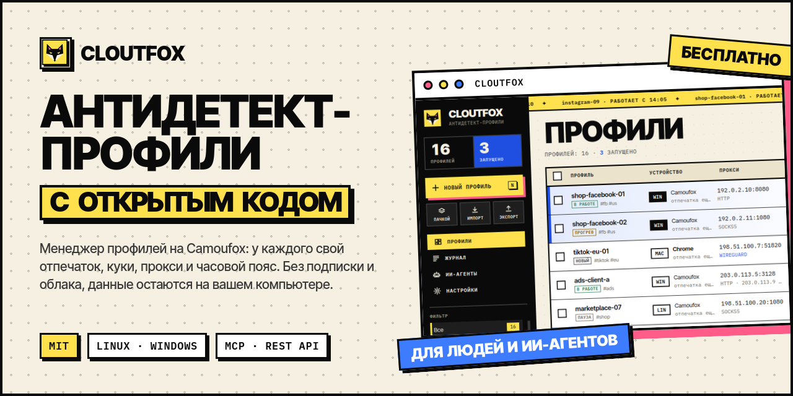
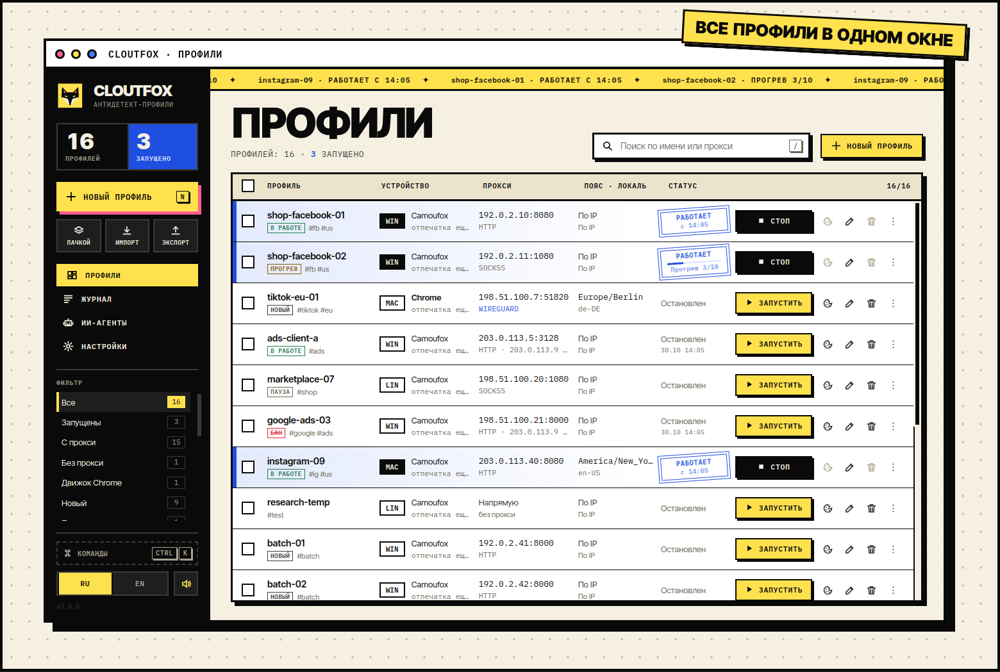
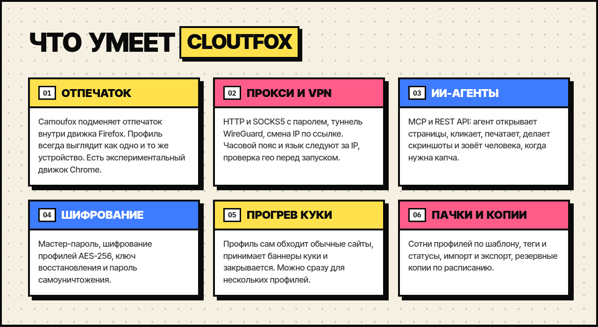
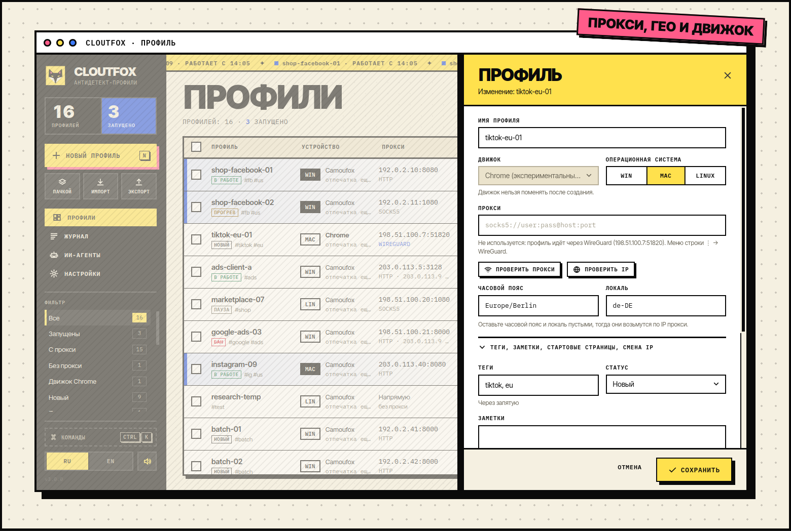
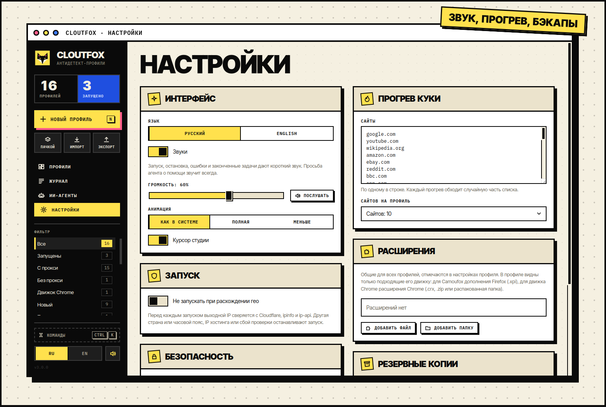
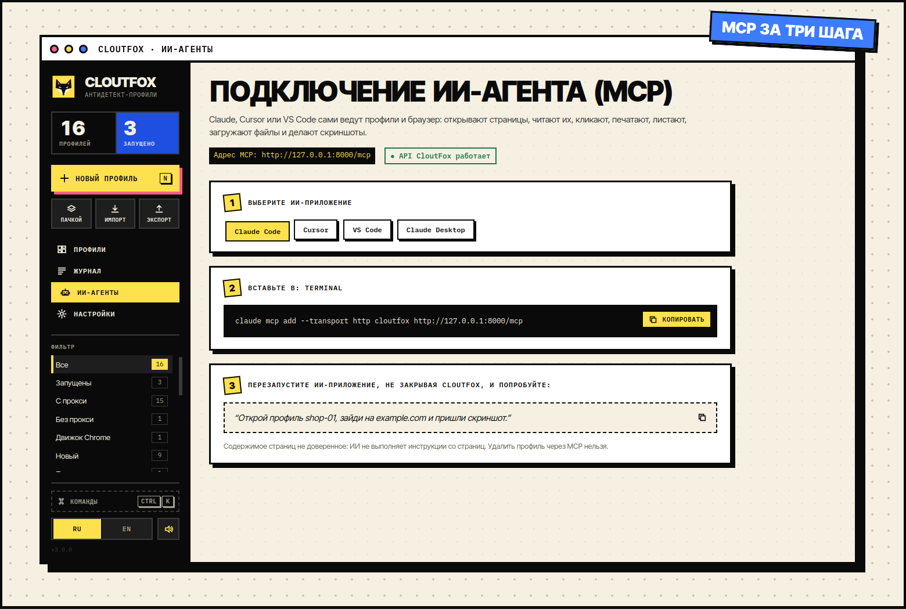

<p align="center">
  
</p>

<p align="center">
  <a href="https://github.com/cloutlab-studio/cloutfox/releases/latest"></a>
  <a href="https://github.com/cloutlab-studio/cloutfox/actions/workflows/ci.yml"></a>
  <a href="LICENSE"></a>
  
</p>

<p align="center">
  <a href="README.md">English</a> · <b>Русский</b>
</p>

<p align="center">
  <a href="#скачать"><b>Скачать</b></a> ·
  <a href="#что-умеет">Что умеет</a> ·
  <a href="#ии-агенты-и-mcp">ИИ-агенты</a> ·
  <a href="#из-исходников">Из исходников</a> ·
  <a href="CHANGELOG.md">Что нового</a>
</p>

**CloutFox** это бесплатный менеджер антидетект-профилей браузера с открытым кодом. У каждого профиля свой отпечаток устройства, куки, прокси или туннель WireGuard, часовой пояс и язык, поэтому сайты видят разных людей на разных компьютерах. Браузер по умолчанию [Camoufox](https://github.com/daijro/camoufox): Firefox, в котором отпечаток подменяется внутри движка. Есть экспериментальный движок Chrome.

Профилями управляют из окна приложения, а скрипты и ИИ-агенты (Claude, Cursor, VS Code) работают через REST API и MCP на `127.0.0.1`. Подписки и облака нет: профили, куки и ключи остаются на вашем компьютере.

<p align="center">
  
</p>

## Скачать

Готовые сборки лежат на странице [последнего выпуска](https://github.com/cloutlab-studio/cloutfox/releases/latest). Python и остальное уже внутри, ставить ничего заранее не нужно.

| Система | Файл | Как поставить |
| --- | --- | --- |
| **Windows 10, 11** | `CloutFox-<версия>-setup-x64.exe` | Запустите и следуйте шагам. Права администратора не нужны, можно поставить и для всех пользователей. |
| Windows, для администраторов | `CloutFox-<версия>-x64.msi` | Для групповой политики и тихой установки: `msiexec /i CloutFox-<версия>-x64.msi /qn` |
| Windows без установки | `CloutFox-<версия>-windows-x64.zip` | Распакуйте и запустите `CloutFox.exe`. |
| **Ubuntu 22.04+, Debian 12+**, Mint | `cloutfox_<версия>_amd64.deb` | `sudo apt install ./cloutfox_<версия>_amd64.deb` |
| **Fedora**, RHEL 9+, openSUSE | `cloutfox-<версия>-1.x86_64.rpm` | `sudo dnf install ./cloutfox-<версия>-1.x86_64.rpm` или `sudo zypper install ./…` |
| **Arch**, Manjaro | AUR `cloutfox-bin` (скоро) | Пока пакета в AUR нет, возьмите AppImage или tar.gz ниже. |
| Любой Linux | `CloutFox-<версия>-x86_64.AppImage` | `chmod +x CloutFox-*.AppImage` и запустите. |
| Любой Linux | `cloutfox-<версия>-linux-x86_64.tar.gz` | Распакуйте и запустите `./cloutfox`. |
| Исходный код | `cloutfox-<версия>-src.tar.gz` | См. [«Из исходников»](#из-исходников). |

- **Первый запуск.** CloutFox один раз скачивает браузер Camoufox (около 700 МБ) с его страницы на GitHub; ход загрузки виден в «Журнале». Пока загрузка идёт, профиль Camoufox ждёт её и запускается сам.
- **Windows и SmartScreen.** Сборки для Windows пока без цифровой подписи, и Windows покажет «Windows защитила ваш компьютер». Нажмите «Подробнее» → «Выполнить в любом случае».
- **Проверка файлов.** Рядом со сборками лежит `SHA256SUMS`: `sha256sum -c SHA256SUMS --ignore-missing` на Linux, `Get-FileHash <файл>` в PowerShell.
- **Требования.** Процессор x86_64, Windows 10 или 11, Linux с glibc 2.34+ (Ubuntu 22.04, Debian 12, Fedora 36, RHEL 9 и новее), 4 ГБ памяти, около 4 ГБ на диске вместе с Camoufox.
- **Обновление.** Поставьте новую версию поверх старой. Профили, куки и настройки не трогаются.
- **Удаление.** «Приложения» в Windows, `sudo apt remove cloutfox` или `sudo dnf remove cloutfox` на Linux. Данные остаются в папке данных (ниже), удалите её вручную, если они не нужны.

### Где лежат данные

На Linux в `~/.local/share/cloutfox`, на Windows в `%LOCALAPPDATA%\CloutFox`. Другая папка задаётся переменной `CLOUTFOX_HOME`.

```text
profiles.json                      список профилей (с мастер-паролем зашифрован)
camoufox_data/<профиль>/           куки, история, localStorage, fingerprint.json, tabs.json
encrypted_data/<профиль>.cfx       зашифрованные профили
vault.json, profile_keys.json      ключи в зашифрованном виде (только если шифрование включено)
settings.json                      настройки со страницы «Настройки»
extensions/<id>/                   общие расширения браузера
bin/                               wireproxy для профилей с WireGuard (скачивается сам)
logs/cloutfox_ГГГГММДД.log         журнал за день
logs/crash.log                     ошибки, из-за которых приложение не запустилось
```

В `camoufox_data/` лежат куки всех аккаунтов: не пересылайте эту папку и не выкладывайте её в репозитории.

API и MCP работают только вместе с приложением и слушают только `127.0.0.1`. Чтобы браузеры агентов открывались без окон, задайте `CLOUTFOX_HEADLESS=true`.

## Что умеет

<p align="center">
  
</p>

<table>
  <tr>
    <td width="50%"></td>
    <td width="50%"></td>
  </tr>
  <tr>
    <td>Редактор профиля: движок, ОС, прокси, часовой пояс, язык, теги и заметки.</td>
    <td>Настройки: звук и анимация, прогрев куки, расширения, резервные копии, шифрование.</td>
  </tr>
</table>

## Панель

- **Страницы** в чёрной панели слева: «Профили», «Журнал», «ИИ-агенты» (подключение MCP) и «Настройки». Там же счётчики, фильтры, язык и звук.
- **Клавиши.** `Ctrl+K`: палитра команд (найти профиль, запустить, открыть настройки). `/`: поиск. `N`: новый профиль. Пробел: запустить или остановить единственный выбранный профиль. `Esc`: закрыть окно.
- **Звуки** короткие и синтезируются в самой панели, файлов со звуками нет. Их можно выключить, громкость в «Настройках» → «Интерфейс». Сигнал о просьбе агента звучит всегда.
- **Анимация** следует настройке системы «уменьшить движение»; в «Настройках» её можно оставить полной или уменьшить. Там же выключается курсор студии.
- **Язык.** Русский или английский. По умолчанию CloutFox берёт язык системы; `CLOUTFOX_LANG` или переключатель в боковой панели его меняют.

## Работа с профилями

- **Теги, статус, заметки.** Статусы: новый, прогрев, в работе, пауза, бан. Самые частые теги и статусы появляются в фильтре слева, поиск ищет и по тегам, и по заметкам.
- **Последний запуск.** В строке профиля видно время последнего запуска, выходной IP и страну.
- **Стартовые страницы.** Открываются при запуске, если от прошлой сессии не осталось вкладок.
- **Ссылка смены IP** для мобильных прокси. Вызывается перед каждым запуском и из меню строки (⋮ → «Сменить IP прокси»). Через `CLOUTFOX_ROTATE_WAIT` секунд (по умолчанию 8) CloutFox продолжает запуск. В API ссылка не показывается, только признак `has_rotate_url`.
- **Много профилей.** Можно создать их по шаблону имени (`fb-{n}` × 20) с раздачей прокси по порядку или случайно. Можно вставить список строк `имя;прокси;теги;заметка`, например выгрузку из другого антика.
- **Изменить выбранные.** Новые прокси, статус, добавить или убрать теги сразу у всех выбранных.
- **Клонировать.** Те же настройки, но без куки и с новым отпечатком.

## WireGuard

У профиля вместо прокси может быть туннель WireGuard: меню строки ⋮ → «WireGuard», загрузить `.conf` от VPN-провайдера или своего сервера. Пока туннель задан, прокси профиля не используется, а в строке профиля вместо прокси виден адрес сервера WireGuard. «Проверить IP» в том же окне проверяет выход через туннель.

- Туннель поднимает [wireproxy](https://github.com/windtf/wireproxy) (WireGuard без прав администратора). При первом профиле с WireGuard CloutFox скачивает wireproxy 1.1.3 с GitHub и сверяет SHA-256. Сборки есть для Linux (x86_64, arm64) и Windows (x64).
- Конфиг хранится в папке данных профиля (`wireguard.conf`). У зашифрованного профиля он зашифрован вместе с профилем, в API и MCP не отдаётся, попадает в ZIP-экспорт профиля и в резервные копии. При клонировании туннель не копируется: два профиля с одним ключом мешают друг другу.
- Из файла берутся только ключи WireGuard (`PrivateKey`, `Address`, `DNS`, `MTU`, `PublicKey`, `PresharedKey`, `Endpoint`, `AllowedIPs`, `PersistentKeepalive`). `PostUp`, `ListenPort` и разделы самого wireproxy вроде `[Socks5]` отбрасываются.
- При запуске wireproxy открывает HTTP-прокси на `127.0.0.1` со случайным портом и новым случайным логином и паролем. Браузер ходит к нему через локальный мост (о нём ниже, в разделе про прокси), мост сам подставляет логин и пароль.
- Туннель с выходом в интернет (`AllowedIPs = 0.0.0.0/0` или `::/0`): при запуске CloutFox узнаёт выходной IP для часового пояса и гео. Если выход не отвечает, профиль не запускается.
- Туннель во внутреннюю сеть (в `AllowedIPs` только часть адресов, например офисная сеть `10.0.0.0/8`): выходного IP нет, и CloutFox его не ищет. Такой профиль запускается, только если у него закреплены часовой пояс и язык, иначе запуск остановится с причиной в журнале. WebRTC в браузере выключен, проверка гео перед запуском пропускается, в строке профиля после запуска написано «IP НЕИЗВЕСТЕН». Сайты вне этой сети через такой туннель не открываются.
- REST: `PUT /profiles/{name}/wireguard` с `{"config": "..."}`, `DELETE /profiles/{name}/wireguard`. Поле `wireguard` у профиля содержит адрес сервера. Через MCP туннель не задаётся.

## Расширения, проверка гео, резервные копии

Настраивается в «Настройках» (шестерёнка внизу слева).

- **Расширения.** Добавляются один раз для всех профилей: файл `.xpi`, `.crx`, `.zip` или распакованная папка. В настройках профиля отмечается, какие из них он загружает, и там видны только расширения для движка профиля. Для Camoufox подходят дополнения Firefox (`.xpi`, например с addons.mozilla.org, или папка с ключом `gecko` в `manifest.json`), для Chrome подходят расширения Chrome (`.crx`, `.zip` или папка). В «Настройках» у каждого расширения написан его движок. Отмеченное раньше расширение другого движка при запуске пропускается, об этом есть строка в журнале. Расширение начинает работать со следующего запуска. Агент видит список через `GET /extensions` (MCP `list_extensions`) и может отметить уже добавленные, но не добавить новое.
- **Не запускать при расхождении гео.** Перед каждым запуском выходной IP проверяется через Cloudflare, ipinfo и ip-api, как в «Проверить IP». Запуск останавливается, если страна или часовой пояс не совпадают, IP принадлежит хостингу, браузер выходит в сеть с другого IP (IPv4 и IPv6) или проверка не прошла. Причина пишется в журнал. Каждый запуск дольше на несколько секунд, и эти три сервиса видят выходной IP профиля.
- **Резервные копии.** Один файл со списком профилей, ключами, настройками, расширениями и данными всех профилей. Выберите папку (лучше на другом диске), интервал и сколько копий хранить, или нажмите «Сделать копию». С мастер-паролем копия зашифрована (`.cfxbak`) и открывается мастер-паролем или ключом восстановления, действовавшими на момент копии. Без мастер-пароля это обычный ZIP, в котором куки и логины прокси читаются. Данные запущенного зашифрованного профиля попадают в копию в том виде, в каком были упакованы последний раз (не старше 10 минут). Копии сверх лимита удаляются обычным удалением, а пароль самоуничтожения затирает их перед удалением. Восстановление в пустую папку:

  ```bash
  .venv/bin/python -m src.services.backup restore ~/backups/cloutfox-backup-20261029-120000.cfxbak ~/cloutfox-restored
  CLOUTFOX_HOME=~/cloutfox-restored ./run.sh
  ```

## Прогрев куки

Перед работой профиль может сам походить по обычным сайтам и набрать куки: меню строки ⋮ → «Прогреть куки» или кнопка «Прогреть» для выбранных профилей.

- Сайты берутся из общего списка в «Настройках» → «Прогрев куки» (для начала там 30 крупных сайтов, список можно править). В окне прогрева можно вставить свой список на этот раз. Каждый профиль обходит свою случайную часть списка, по умолчанию 10 сайтов.
- На каждом сайте от 20 до 60 секунд: принять баннер куки, полистать, перейти по 1–3 ссылкам внутри сайта. Ссылки входа, выхода, регистрации, корзины и файлов пропускаются.
- Профиль запускается как обычно: свой прокси или туннель, отпечаток, проверка гео. Прогрев идёт в одной вкладке, всплывающие окна закрываются. Потом браузер закрывается сам, вкладки прогрева не попадают в список вкладок для следующего запуска. Остановить прогрев можно кнопкой Stop.
- В строке профиля во время прогрева виден счётчик «Прогрев 3/10», в журнале строка на каждый сайт.
- REST: `POST /browser/{name}/warmup` с `{"urls": [...], "count": 10}` (оба поля необязательны), ход прогрева в `GET /browser/{name}/warmup`.

## Шифрование

Всё по желанию, по умолчанию выключено. Включается в «Настройках» (шестерёнка внизу слева) и в меню строки профиля (⋮ → «Шифрование»).

- **Мастер-пароль.** Спрашивается при запуске CloutFox. Им шифруются `profiles.json` (там логины прокси), бэкапы и ключи зашифрованных профилей. Пока мастер-пароль не введён, API и MCP выключены. При включении один раз показывается ключ восстановления: сохраните его, без него забытый мастер-пароль не сбросить.
- **Шифрование профиля.** Куки, история и хранилище профиля лежат в `encrypted_data/<профиль>.cfx` (AES-256-GCM, ключи из паролей через Argon2id). С мастер-паролем свой пароль у профиля можно не задавать; если задать, он станет вторым замком. Без мастер-пароля пароль профиля обязателен и спрашивается при первом запуске профиля после старта CloutFox. Агент через API получит `423` для профиля, пароль которого ещё не введён.
- **Где лежат открытые данные.** Пока профиль запущен, его данные распакованы: на Linux в памяти (`/dev/shm`), на Windows во временной папке на диске. После остановки они упаковываются обратно, а пока профиль работает, сохраняются каждые 10 минут. Распакованный профиль занимает столько же оперативной памяти, сколько весит на диске.
- **Пароль самоуничтожения.** Работает только с мастер-паролем. Если ввести его на экране входа вместо мастер-пароля, CloutFox сначала затирает ключи (с этого момента данные не прочитать), потом удаляет профили, куки, журналы и бэкапы и открывается пустым, как после установки. Отменить это нельзя.
- **Выключение мастер-пароля.** Профили, зашифрованные только мастер-паролем, расшифровываются. Профили со своим паролем остаются зашифрованными.
- Экспорт зашифрованного профиля в ZIP даёт обычный, незашифрованный архив.

## ИИ-агенты и MCP

<p align="center">
  
</p>

Пока CloutFox запущен, MCP доступен по `http://127.0.0.1:8000/mcp`:

```bash
claude mcp add --transport http cloutfox http://127.0.0.1:8000/mcp
```

Готовые конфиги для Cursor, VS Code и Claude Desktop есть на странице «ИИ-агенты».

| Инструменты | Что делают |
| --- | --- |
| `list_profiles` (`tag`, `status`), `get_profile`, `create_profile`, `update_profile` | профили (удаления через MCP нет) |
| `create_profiles_bulk`, `clone_profile`, `set_proxies`, `rotate_proxy_ip` | много профилей, клон, прокси пачкой, смена IP |
| `list_extensions` | добавленные расширения и их движок; `id` подходящих передаются в `extensions` профиля |
| `launch_profile`, `stop_profile`, `running_profiles` | запуск и остановка браузера |
| `warm_up_profile`, `warmup_status` | прогрев куки и его ход |
| `launch_temp_profile` | одноразовый профиль: свежий отпечаток, удаляется вместе с данными при остановке |
| `request_human`, `check_human_request` | позвать человека (капча, 2FA, вход) и дождаться ответа |
| `browser_broadcast` | одно действие сразу в нескольких запущенных профилях |
| `export_cookies`, `import_cookies`, `get_fingerprint`, `reset_fingerprint` | куки и отпечаток остановленного профиля |
| `check_proxy`, `check_profile_ip` | проверка прокси и расхождений гео |
| `browser_navigate`, `browser_back`, `browser_forward`, `browser_reload` | переходы |
| `browser_snapshot`, `browser_get_text`, `browser_screenshot` | чтение страницы |
| `browser_click`, `browser_click_at`, `browser_hover`, `browser_drag` | мышь |
| `browser_type` (`delay_ms`), `browser_keyboard_type`, `browser_press` | клавиатура |
| `browser_scroll`, `browser_select`, `browser_wait_for`, `browser_pause` | прокрутка, списки, ожидание |
| `browser_upload` | файлы в `<input type=file>` или в окно выбора файла |
| `browser_dialogs` | alert/confirm/prompt: последние диалоги и как отвечать на следующие |
| `browser_evaluate`, `browser_tabs`, `browser_tab_new`, `browser_tab_select`, `browser_tab_close` | JS и вкладки |

`browser_upload` берёт только медиафайлы (`CLOUTFOX_UPLOAD_EXTENSIONS`: картинки, видео, аудио) из `CLOUTFOX_UPLOAD_DIRS` (по умолчанию `~/Pictures` и `~/Videos`) и отказывает для скрытых путей и файлов, похожих на ключи (`.kdbx`, `.pem`, `.key`, `id_*` и т. п.): агент читает чужие страницы, и его могут попросить «загрузить» SSH-ключ или документы. Свою папку с материалами добавьте в `.env`: `CLOUTFOX_UPLOAD_DIRS=~/Pictures:~/Videos:~/work/posts`.

Каждое действие агента на странице записывается в журнал профиля (⋮ → «Журнал агента», `GET /browser/{name}/activity`). В журнал попадают селекторы, клавиши и координаты. Набранный текст, ответы на диалоги и скрипты сохраняются только как длина, у адресов отрезаются параметры после `?`. Когда агент вызывает `request_human`, панель закрывается карточкой с его просьбой и кнопками «Показать окно», «Готово» и «Не могу». Окно CloutFox при этом разворачивается и держится поверх остальных окон, пока вы не ответите, и звучит короткий сигнал. В режиме `CLOUTFOX_HEADLESS=true` окна браузера нет, и ответ сообщает об этом агенту.

На живых аккаунтах работайте как человек: печать с `delay_ms`, `browser_pause` между шагами, без серий действий подряд.

## Настройки

Всё необязательно, шаблон в `.env.example`.

| Переменная | По умолчанию | Значение |
| --- | --- | --- |
| `CLOUTFOX_LANG` | язык системы | язык интерфейса: `ru` или `en` |
| `CLOUTFOX_HOME` | `~/.local/share/cloutfox`, на Windows `%LOCALAPPDATA%\CloutFox` | папка данных (можно задать в `.env`) |
| `CLOUTFOX_UPLOAD_DIRS` | `~/Pictures:~/Videos` | откуда `browser_upload` может брать файлы |
| `CLOUTFOX_UPLOAD_EXTENSIONS` | картинки, видео, аудио | какие типы файлов можно загружать |
| `CLOUTFOX_HEADLESS` | `false` | `true`: браузеры без окон |
| `CLOUTFOX_RESTORE_TABS` | `true` | открывать вкладки прошлого запуска |
| `CLOUTFOX_API_TOKEN` | пусто | токен для API и MCP (24+ символа); без него API доступен любой программе на этом компьютере |
| `CLOUTFOX_API_PORT` | `8000` | порт API на `127.0.0.1` |
| `CLOUTFOX_PROXY_TIMEOUT`, `CLOUTFOX_LAUNCH_TIMEOUT` | `10`, `90` | таймауты в секундах |

Прокси: `host:port`, `http://`, `https://`, `socks4://`, `socks5://`, с `user:pass@` или в виде `host:port:user:pass`. Пусто: прямое подключение.

SOCKS5 с паролем Camoufox сам не принимает, поэтому на время запуска CloutFox поднимает мост на `127.0.0.1` со случайным портом: браузер ходит в мост без пароля, мост входит на прокси с логином и паролем и передаёт ему имена сайтов, DNS не идёт мимо прокси. Мост закрывается вместе с браузером. Через такой же мост Camoufox ходит в туннель WireGuard, а движок Chrome ходит через мост к любому прокси.

На Linux мост пропускает только программы вашего пользователя ОС: соединение от другого пользователя этого компьютера получает отказ. На Windows такой проверки нет: пока профиль запущен, через мост может выйти в сеть любая программа компьютера, если найдёт порт. Логин и пароль прокси передаются браузеру через окружение процесса, в командной строке (её видят все пользователи) их нет.

REST API с документацией: `http://127.0.0.1:8000/docs`.

## Из исходников

Нужны Python 3.10+ и git:

```bash
git clone https://github.com/cloutlab-studio/cloutfox.git
cd cloutfox
python -m venv .venv
.venv/bin/pip install -r requirements.txt     # Windows: .venv\Scripts\pip
.venv/bin/python -m camoufox fetch            # необязательно: иначе скачается при первом запуске
./run.sh                                      # Windows: run_cloutfox.bat
```

`run.sh` и `run_cloutfox.bat` запускают приложение из папки с кодом; данные лежат там же, где у установленной версии. `CLOUTFOX_HOME` можно задать и в `.env` рядом с кодом (шаблон в `.env.example`).

### Сборка пакетов

Пакеты собирает `packaging/build.py` на Python 3.11+: сначала самодостаточная сборка приложения (свой Python из [python-build-standalone](https://github.com/astral-sh/python-build-standalone), зависимости и код), потом пакеты из неё. Всё, что скачивается при сборке, закреплено по версии и SHA-256.

```bash
python packaging/build.py bundle      # build/bundle/cloutfox для текущей ОС
python packaging/build.py linux       # deb, rpm, AppImage, tar.gz, PKGBUILD для AUR (на Linux)
python packaging/build.py windows     # exe (Inno Setup), msi (WiX 5), zip (на Windows с MSVC)
python packaging/build.py source      # архив исходников
python packaging/build.py checksums   # dist/SHA256SUMS
```

`packaging/test_package.sh` ставит пакет в чистом контейнере и проверяет, что все библиотеки находятся и приложение открывается. Выпуск собирает GitHub Actions по тегу `vX.Y.Z` (`.github/workflows/release.yml`): пакеты, их установка на Debian, Ubuntu, Fedora, openSUSE, Arch и Windows, черновик выпуска с файлами и `SHA256SUMS`.

## Разработка

```bash
.venv/bin/pip install -r requirements-dev.txt
.venv/bin/ruff check src tests chrome_engine packaging docs cloutfox_app.py cloutfox_mcp.py
.venv/bin/ruff format --check src tests chrome_engine packaging docs cloutfox_app.py cloutfox_mcp.py
.venv/bin/python -m pytest
```

GitHub Actions прогоняет то же на Linux и Windows, проверяет панель (`npm run check`, `npm test`) и остановку браузера на Windows (`tests/e2e/stop_e2e.py`). Как предложить изменение: [CONTRIBUTING.md](CONTRIBUTING.md). Об уязвимостях: [SECURITY.md](SECURITY.md).

Панель лежит в `frontend/` (Svelte 5, Vite, TypeScript). Готовая сборка хранится в `src/ui/dist`, поэтому для запуска Node не нужен. После правки панели нужен Node 20+:

```bash
cd frontend
npm ci
npm run dev      # панель в обычном браузере на тестовых данных: http://localhost:5199
npm run check    # svelte-check
npm test         # vitest
npm run build    # пересобрать src/ui/dist; tests/test_frontend_build.py проверяет, что сборка свежая
```

Картинки для этого README собираются из `docs/images/src/images.ru.html` (английские из `images.html`, стили общие в `images.css`) командой `python docs/images/src/render.py`. Снимки окна в `docs/images/src/screens/ru` сделаны на выдуманных профилях с адресами из документационных диапазонов.

Мультиаккаунтинг может нарушать правила площадок: отвечаете за это вы.

## Лицензия

Код CloutFox распространяется по лицензии MIT, текст в [`LICENSE`](LICENSE). Copyright (c) 2026 Cloutlab.

Готовые сборки содержат сторонние компоненты со своими лицензиями: Python (PSF), Qt и PyQt6 (GPLv3 для PyQt6, LGPLv3 для Qt), Playwright (Apache-2.0) и другие. Их список и тексты лежат в сборке в файле `THIRD-PARTY-LICENSES.txt`. Camoufox (MPL-2.0) в сборки не входит и скачивается при первом запуске.

---

<p align="center">
  Сделано в студии <a href="https://cloutlab.studio"><b>Cloutlab</b></a>
</p>
